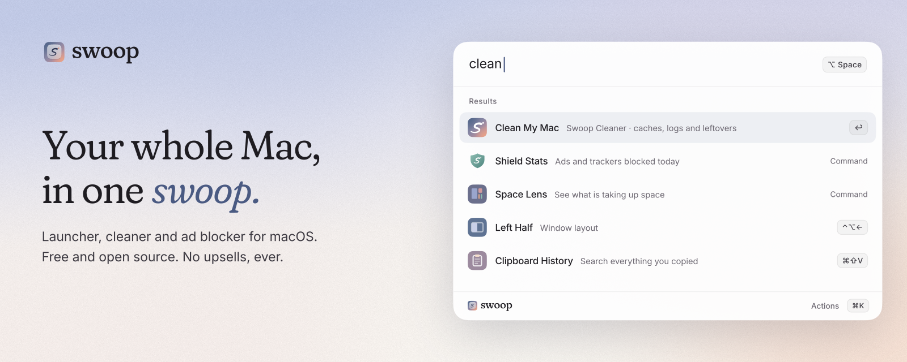

<p align="center">
  <picture>
    <source media="(prefers-color-scheme: dark)" srcset="docs/assets/readme-header-dark.png">
    
  </picture>
</p>

# Swoop

**A free, open-source launcher, Mac cleaner and system-wide ad blocker in one native app.** Raycast-style search, clipboard history, snippets and window management; a CleanMyMac-style cleaner that explains every item and can undo everything it removes; and Swoop Shield, which blocks ads, trackers and malware for every app and browser on your Mac.

macOS 13 Ventura or later · Apple silicon and Intel (universal) · Swift / SwiftUI + AppKit · MIT licence · [swoopkey.com](https://swoopkey.com)

No accounts, no subscriptions, no upsells, no telemetry. Swoop is not on the Mac App Store: the App Sandbox would stop a launcher and cleaner from doing their job.

## Launcher

Press **⌥Space** (or any shortcut you record, including ⌘Space or a double-tapped modifier such as ⌥⌥).

- **Fuzzy search** across apps, System Settings panes, Swoop commands, script commands, quicklinks and files (Spotlight), ranked by how often and how recently you use things. ⌘F pins a result to Favourites.
- **Action panel** (⌘K) on every result: open, show in Finder, quit, force quit, uninstall, copy path, Quick Look, upload to Google Drive, move to Trash… ⌘↩ runs the second action; ⌘1–9 runs a row.
- **Calculator**: arithmetic, percentages, powers, factorials, functions (`sqrt`, `sin`, `log`…), constants, and offline unit conversions (`10 km to mi`, `72 f in c`, `1.5 GB to MB`, `60 mph to km/h`). No currencies (they need live rates).
- **Clipboard history**: text, images and files; search, pin (⌘P), paste into the previous app (↩) or copy (⌘↩). Skips concealed/transient pasteboard types and password managers (1Password, Bitwarden, LastPass, Dashlane, KeePassXC, Keychain Access, Passwords). Local only.
- **Snippets** with text expansion keywords and placeholders: `{clipboard} {date} {time} {datetime} {day} {date:yyyy-MM-dd} {uuid} {cursor}`. Never expands in secure (password) fields.
- **Quicklinks**: URL templates with `{query}`; type `gh swoop` to run the `gh` quicklink.
- **Window management** via the Accessibility API, each layout with its own re-bindable hotkey: left/right/top/bottom half, four quarters, thirds, two-thirds, maximize, almost maximize, center, restore, next/previous display.
- **System commands**: lock, sleep, sleep displays, empty Trash, toggle dark mode, restart, shut down, log out, eject all disks, toggle hidden files, quit all apps.
- **Emoji picker** built from the system's Unicode data.
- **Script commands**: drop Raycast-compatible scripts (`# @raycast.schemaVersion 1`, `title`, `mode`, `argument1`…) into `~/Library/Application Support/Swoop/Scripts`. Modes: fullOutput, compact, silent, inline. Examples in `examples/scripts`.
- **Web search fallback** (Google, DuckDuckGo, Bing, Kagi or Ecosia).
- **Opens at login** by default (untick "Open Swoop at login" on the last setup step, or change it any time in Settings › General › Startup).
- **Hotkeys for everything**: open Swoop, any command, window layout, clipboard history, cleaner action, script command or quicklink. The recorder warns about conflicts with Swoop's other bindings, with macOS's own shortcuts (read from your Keyboard Shortcuts settings, so ⌘Space shows how to free it from Spotlight), and with combinations another app has already taken.

## Shield: system-wide ad blocking

Settings › Shield, or type "shield" in the launcher. Full design and setup: [`docs/SHIELD.md`](docs/SHIELD.md).

- **Every app and browser:** a NetworkExtension system extension (DNS proxy + content filter) blocks ad, tracker, telemetry and malware domains for the whole Mac. Without the extension there's a **local resolver** fallback on 127.0.0.1 (same lists and stats, one admin password) and an **encrypted DNS profile** option (AdGuard DNS, Mullvad or Quad9; that one isn't on-device).
- **Hard to get around:** turns off Firefox's automatic DNS-over-HTTPS (canary domain), makes public DoH resolvers unreachable so browsers fall back to Shield, and in extension mode drops DNS-over-TLS/QUIC and DoH connections to known resolver IPs. Can optionally ask iCloud Private Relay to step aside.
- **CNAME uncloaking:** catches trackers disguised as a site's own subdomain by checking every name in the CNAME/HTTPS alias chain.
- **Filter lists**, downloaded straight from their maintainers and refreshed about once a day: HaGeZi Multi PRO / NORMAL, OISD big, AdGuard DNS filter, EasyList, EasyPrivacy, Peter Lowe's list, URLhaus malware, plus optional HaGeZi telemetry lists and AdGuard's CNAME-tracker list. Each download is checked (format, title, rule count, sudden drops, SHA-256) before it's used. The lists compile to a compact binary trie + Bloom filter index (about 475k domains in about 15 MB, lookups take microseconds).
- **Browsers:** Safari content blockers (6 extensions, split under Safari's rule limit) and a Safari Web Extension, plus a Manifest V3 extension for Chrome, Arc, Brave, Edge, Vivaldi, Opera and Firefox (declarativeNetRequest, cosmetic filtering, scriptlets). **Honest limits:** DNS blocking can't remove ads served from the same domain as the content, such as YouTube video ads or sponsored posts. The browser extensions handle those best-effort, and YouTube changes often.
- **Works with Pax:** if [Pax](https://paxpeace.com) is on the Mac, Shield never touches DNS, `/etc/hosts` or the firewall and never blocks Pax's servers; it blocks ads in your browsers instead, and the cleaner never removes or disables Pax. See [Using Swoop with Pax](docs/SHIELD.md#using-swoop-with-pax).
- **Control:** on/off, pause (5 min, 1 h, until tomorrow), per-app and per-site pause, an allowlist, custom rules in Adblock or hosts syntax with live validation, top blocked domains and apps, a searchable query log (stored only on this Mac, auto-deleted), a blocked-today counter in the menu bar, and launcher commands ("Pause Ads for 5 Minutes", "Allow This Site", "Shield Stats"…), each bindable to a hotkey.
- **Private:** everything runs on the Mac. No telemetry, and nothing about what you browse leaves the machine.

### Filter list credits

Swoop doesn't redistribute these lists; your Mac downloads them from their maintainers. Thank you to:

| List | Maintainer | Licence |
| --- | --- | --- |
| [EasyList, EasyPrivacy](https://easylist.to/) | The EasyList authors | GPL-3.0 or CC BY-SA 3.0 ([licence](https://easylist.to/pages/licence.html)) |
| [AdGuard DNS filter](https://github.com/AdguardTeam/AdGuardSDNSFilter) | AdGuard | GPL-3.0 |
| [AdGuard cname-trackers](https://github.com/AdguardTeam/cname-trackers) (optional) | AdGuard | MIT |
| [HaGeZi DNS blocklists](https://github.com/hagezi/dns-blocklists) (Multi PRO / NORMAL, native trackers) | HaGeZi | GPL-3.0 |
| [OISD](https://oisd.nl) big | OISD (sjhgvr) | GPL-3.0 |
| [Peter Lowe's ad and tracking server list](https://pgl.yoyo.org/adservers/) | Peter Lowe | Free to use; no formal licence ([policy](https://pgl.yoyo.org/adservers/policy.php)) |
| [URLhaus malicious URL blocklist](https://gitlab.com/malware-filter/urlhaus-filter) | curbengh / abuse.ch URLhaus | CC0-1.0 (data), MIT (scripts) |

The browser-extension zips built by CI include compiled rules and an `ATTRIBUTION.md` with each list's version, source and SHA-256. Swoop's own code and built-in rules are MIT.

## Cloud

- **Google Drive**: sign in with OAuth 2.0 (loopback redirect + PKCE, tokens in your Keychain), search Drive from the launcher, open files in the browser, copy links, and quick-upload a file (the link is copied when it's done). Read-only Drive scope plus `drive.file` for uploads.
  Just press **Sign in with Google** in **Settings › Cloud** (or run “Search Google Drive”) and allow access. Swoop uses its own Google client; you can swap in your own under Settings › Cloud › Advanced, or bake one in at build time with `GOOGLE_CLIENT_ID=… GOOGLE_CLIENT_SECRET=… ./scripts/build-app.sh`.
- **iCloud Drive**: search and size the local iCloud Drive folder; no sign-in.
- **Built to extend**: every service implements one `CloudProvider` protocol (search, usage, large files) on shared OAuth/PKCE/loopback pieces, so Dropbox and OneDrive slot in next.

## Cleaner

Nothing is removed without your review. Items go to the Trash by default (permanent deletion is a setting), and **every removal is logged with its reason, so you can put it back** from *Restore*.

- **Smart Scan**: System Junk, leftovers of deleted apps, a security check, files over 1 GB and app updates in one pass, with a review screen.
- **System Junk**: app caches, logs, Xcode DerivedData / Archives (off by default) / device support / simulator caches, unfinished downloads (older than a day), browser caches (Chrome, Brave, Edge, Arc, Firefox, Safari, Opera), unused app localisations (off by default) and the Trash (off by default). Each item has a **"Why this is safe"** note.
- **Space Lens**: an interactive treemap of your home folder, the whole disk or any folder; click to drill in, reveal or remove.
- **Large & Old Files** with size, last-used and kind filters. Nothing pre-selected.
- **Duplicates**: byte-identical files (size, then 64 KB hash, then full SHA-256); the oldest copy of each group is kept.
- **Uninstaller**: removes an app with its Application Support, Caches, Preferences (incl. ByHost), Containers, Group Containers, LaunchAgents, Saved State, Logs, HTTPStorages, WebKit and Cookies, matched by bundle ID (name matches are shown but not pre-selected). A second tab finds **leftovers of apps you already deleted**, checked against every installed app, its helpers and Launch Services. Apple apps can't be uninstalled.
- **Login Items**: your Launch Agents, all-users agents and system daemons with on/off switches (system items ask for an admin password), plus legacy "Open at Login" items.
- **Security Check**: looks at the places adware and malware use to persist (Launch Agents/Daemons, privileged helpers), browser extensions (Chrome, Brave, Edge, Arc, Vivaldi, Firefox) and network proxy settings, and explains every signal: known adware family names, programs in temporary or hidden folders, scripts that download or decode code at launch, unsigned programs, missing programs, disguised labels, random-looking names. Shows the XProtect version. Never removes anything by itself.
- **App Updates**: Sparkle feeds (`SUFeedURL`), the App Store (for App Store apps) and Homebrew's cask index; opens the right updater or runs `brew upgrade --cask`.
- **Maintenance**: flush DNS, reindex Spotlight, rebuild Launch Services, run periodic scripts, purge memory, reset Quick Look, restart Dock and Finder. Each explains what it does; admin tasks use the standard macOS password prompt.
- **Privacy** (all off by default): recent-items lists, Safari/Chrome/Brave/Edge history (bookmarks, passwords and cookies kept; refuses while the browser is open).
- **Cloud Storage**: Google Drive usage (incl. Drive Trash) and largest files; iCloud Drive folder size, how much is downloaded, and largest files.
- **Battery Health**: maximum capacity, cycles, condition, charge and temperature.
- **Scheduled clean-ups**: daily/weekly/monthly for the categories you choose, only above a threshold, always to the Trash (restorable), never emptying the Trash.
- **Menu bar monitor**: CPU and memory in the menu bar, disk free, and quick actions (Free Up RAM, Smart Scan, Restore…).

**Safety rules** (`Sources/SwoopCore/PathSafety.swift`, unit-tested): Swoop only removes things inside your home folder, app bundles in `/Applications` and (opt-in) their `.lproj` folders. It never touches `/System`, `/usr`, `/Library`, `/private` or other SIP/system paths, other users' folders, iCloud Drive, Keychains, Mail, Messages, Photos libraries, iPhone backups, SSH/GPG/cloud credentials, Apple's own containers, or Swoop's own data. Symlinks are never followed out of a safe location.

## Build

Command Line Tools only (`xcode-select --install`); no Xcode project.

```sh
swift build && swift test          # SwoopCore + ShieldCore also build and test on Linux
./scripts/build-app.sh             # dist/Swoop.app + dist/Swoop-0.2.0.dmg (ad-hoc signed)
UNIVERSAL=1 ./scripts/build-app.sh # arm64 + x86_64
open dist/Swoop.app

# Swoop Shield tools (macOS or Linux)
swift run swoop-shield-compile --download --out build/shield   # lists → index + Safari/DNR rules
./scripts/build-webext.sh build/shield                        # Chrome/Firefox/Safari extension
swift run swoop-resolver --dir build/shield --listen 127.0.0.1:5353   # try the resolver (dig @127.0.0.1 -p 5353 …)
node Extensions/webext/test/scriptlets.test.js
```

Signing and notarising: `SIGN_IDENTITY="Developer ID Application: … (TEAMID)" NOTARY_PROFILE=<notarytool profile> ./scripts/build-app.sh`. CI does this automatically when the signing secrets exist (see `docs/SIGNING.md`); otherwise it produces an ad-hoc signed DMG artifact. The Shield system extension also needs `APPLE_TEAM_ID` plus two Developer ID provisioning profiles (`SHIELD_APP_PROFILE`, `SHIELD_EXT_PROFILE`) with the Network Extensions and System Extension capabilities; see [`docs/SHIELD.md`](docs/SHIELD.md#apple-developer-account-setup). Without them, Shield runs in local-resolver, profile and browser modes.

## Layout

```
Package.swift
Sources/SwoopCore/   Foundation-only logic (fuzzy matcher, calculator, snippets, junk rules,
                     path safety, leftovers, hotkeys, script metadata, OAuth/PKCE, Drive API,
                     treemap, security heuristics, appcast/cask parsing, restore log, schedules)
Sources/ShieldCore/  Swoop Shield engine (Foundation + POSIX): list parser, binary domain index,
                     matcher, CNAME uncloaking, encrypted-DNS policy, DNS wire format, Safari/DNR/
                     cosmetic converters, list verification, local resolver
Sources/Swoop/       the macOS app (AppKit + SwiftUI); Shield UI and controller in Swoop/Shield
Sources/SwoopShieldExtension/     NetworkExtension system extension (DNS proxy + content filter)
Sources/SwoopSafariBlocker/       Safari content blocker (packaged as 6 .appex)
Sources/SwoopSafariWebExtension/  Safari Web Extension host
Sources/SwoopResolver/            swoop-resolver, the local DNS fallback daemon
Sources/ShieldCompileTool/        swoop-shield-compile (lists → index + browser rules)
Extensions/webext/   Manifest V3 extension for Chromium, Firefox and Safari (+ scriptlet tests)
Tests/               unit tests (SwoopCoreTests, ShieldCoreTests)
scripts/             build-app.sh (app + DMG), build-webext.sh, check-dnr.py, check-safari.py
Resources/           app icon, entitlements (Resources/Shield: extension entitlements)
docs/                SIGNING.md, SHIELD.md
examples/scripts/    sample Raycast-compatible script commands
```

## Permissions

- **Accessibility**: window management, paste from history/snippets, snippet expansion, double-tap hotkeys.
- **Full Disk Access** (optional): lets the cleaner and Space Lens see protected folders such as Safari's.
- **Automation** prompts appear the first time a command uses System Events/Finder/Terminal (and Safari/Chrome when you use "Allow This Site").
- **Swoop Shield:** approving the system extension (System Settings › General › Login Items & Extensions › Network Extensions) plus the DNS proxy and content filter prompts. Local resolver mode asks for an admin password instead. The Safari extensions are switched on in Safari › Settings › Extensions.

© 2026 DE NORONHA LTD. MIT licence.

## Brand

Logos, the app icon, colours and fonts live in [`docs/brand`](docs/brand) (SVG logos, `palette.css`). The type is Fraunces, Inter and JetBrains Mono, all under the SIL Open Font License. The GitHub social preview is [`docs/assets/social-preview.png`](docs/assets/social-preview.png). Please keep the Swoop name and logo for the official project; forks are welcome under MIT with their own name and mark.
